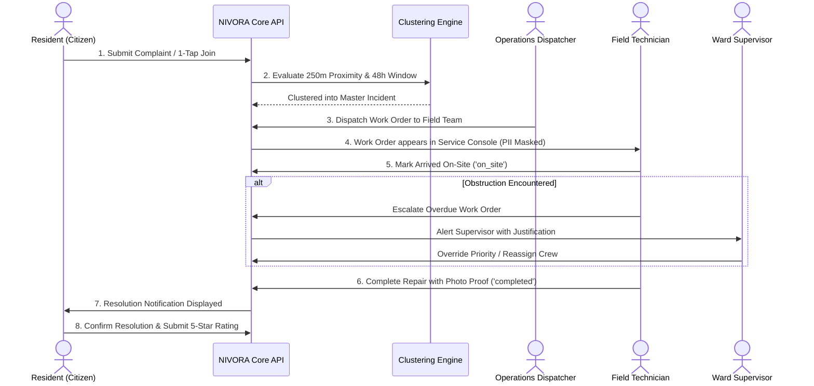

# NIVORA Water Management System — Stage 10: Operational Readiness & Continuous Maintenance Guide

**System Version**: 2.0-STABLE  
**Classification**: Municipal Civic Utility Infrastructure Operations  
**Author**: Senior Full-Stack, Database, QA & Security Engineering Team  
**Date**: October 2026  

---

## 1. System Overview & Architecture Summary

The **NIVORA Water Management System** is a production-hardened municipal water complaint management, geospatial failure clustering, field-crew work order dispatching, and executive water health analytics platform.

- **Frontend Client**: Vanilla TypeScript/ES6 Single-Page Application (`static/index.html`, `static/css/style.css`, `static/js/app.js`) styled in the **Light Purple & Royal Elegant Theme** with Leaflet GIS maps and Chart.js analytics.
- **Backend Service**: High-performance multithreaded Python service (`server.py`, `start_production.py`) powered by `ThreadingHTTPServer`.
- **Database Engine**: Relational SQLite 3 (`nivora.db`) with Write-Ahead Logging (`WAL`), $30\,\text{s}$ busy timeout, and spatial indexing for local operations; Supabase PostgreSQL migrations prepared for cloud staging.
- **Geospatial Engine**: Haversine great-circle clustering ($250\,\text{m}$ spatial radius, $48\,\text{h}$ temporal window) grouping neighbor complaints into Master Incidents.

---

## 2. Production Startup & Process Management

### 2.1 Starting the Application Service

The application runs directly on Python 3.11 with zero external binary dependencies required in the base runtime.

```powershell
# Default startup (Binds to 127.0.0.1:8000):
C:\Users\LENOVO\AppData\Local\Programs\Python\Python311\python.exe start_production.py

# Custom Host and Port Configuration:
$env:PORT = "8080"
$env:HOST = "0.0.0.0"
C:\Users\LENOVO\AppData\Local\Programs\Python\Python311\python.exe start_production.py
```

### 2.2 Production Environment Variables

| Variable | Default Value | Description |
| :--- | :--- | :--- |
| `PORT` | `8000` | Port for the HTTP service to listen on. |
| `HOST` | `127.0.0.1` | Network interface to bind (`0.0.0.0` for container/cloud deployment). |
| `NIVORA_DISABLE_RATE_LIMIT` | `0` | Set to `1` only during offline automated performance load testing. |
| `DATABASE_URL` | Local `nivora.db` | PostgreSQL connection string when connecting to remote Supabase staging. |

### 2.3 Running as a Windows Service (NSSM / Task Scheduler)
To ensure continuous 24/7 uptime on Windows Server:
```powershell
# Using NSSM (Non-Sucking Service Manager):
nssm install NivoraService "C:\Users\LENOVO\AppData\Local\Programs\Python\Python311\python.exe" "C:\Users\LENOVO\Downloads\NIVORA\start_production.py"
nssm set NivoraService AppDirectory "C:\Users\LENOVO\Downloads\NIVORA"
nssm set NivoraService Start SERVICE_AUTO_START
nssm start NivoraService
```

---

## 3. Health Monitoring & Readiness Probes

### 3.1 Operational Health Check
Monitor the service using standard HTTP probes hitting `/api/health`:

```bash
curl -s http://localhost:8000/api/health
```

**Expected JSON Response**:
```json
{
  "status": "healthy",
  "timestamp": "2026-10-25T00:25:00.000000",
  "database": "connected",
  "total_complaints": 10570,
  "total_incidents": 450,
  "total_tickets": 466,
  "wards_monitored": 15,
  "version": "2.0-STABLE"
}
```

- **Uptime Alerting Trigger**: Alert if HTTP status $\ne 200$ or response time $> 500\,\text{ms}$ over 3 consecutive checks.
- **Database Alerting Trigger**: Alert if `database` $\ne$ `"connected"`.

---

## 4. Incident Escalation & Operational Workflows



### 4.1 Field Crew Safety & PII Protection Policy
- Field contractors **must never be provided** direct access to citizen mobile numbers or private flat IDs.
- Navigation must be conducted strictly via verified municipal landmarks and GPS coordinates.
- In emergencies requiring citizen telephone contact, the technician must request a supervised call through the Ward Supervisor Console.

---

## 5. Backup, Disaster Recovery & Database Maintenance

### 5.1 Local SQLite Hot Backup Procedure
Because SQLite is running in Write-Ahead Logging (`WAL`) mode, hot backups can be taken without interrupting active read/write operations:

```powershell
# Create automated timestamped hot backup
$timestamp = Get-Date -Format "yyyyMMdd_HHmmss"
$backupFile = "c:\Users\LENOVO\Downloads\NIVORA\backups\nivora_backup_$timestamp.db"
New-Item -ItemType Directory -Force -Path "c:\Users\LENOVO\Downloads\NIVORA\backups"

# Execute SQLite online backup API via Python
C:\Users\LENOVO\AppData\Local\Programs\Python\Python311\python.exe -c "
import sqlite3
src = sqlite3.connect('nivora.db')
dst = sqlite3.connect('$backupFile')
src.backup(dst)
dst.close()
src.close()
print('Hot backup created successfully: $backupFile')
"
```

### 5.2 Backup Schedule & Retention Policy
- **Hourly Incremental**: Retain for 48 hours (covers active clustering window).
- **Daily Full Snapshot**: Retain for 30 days (stored in off-site cloud storage).
- **Weekly Archive**: Retain for 12 months for municipal compliance auditing.

### 5.3 Disaster Recovery Procedure
In the event of database corruption or hardware failure:
1. Stop the application service: `nssm stop NivoraService` or terminate the Python process.
2. Archive the damaged database file: `Move-Item nivora.db nivora_damaged.db`.
3. Restore from the most recent verified backup: `Copy-Item backups\nivora_backup_YYYYMMDD_HHMMSS.db nivora.db`.
4. Run database integrity verification:
   ```powershell
   C:\Users\LENOVO\AppData\Local\Programs\Python\Python311\python.exe -m unittest backend/tests/test_database_integrity.py
   ```
5. Restart the application service: `nssm start NivoraService`.

---

## 6. Geospatial Clustering Calibration Guide

The clustering parameters in [`backend/clustering.py`](file:///c:/Users/LENOVO/Downloads/NIVORA/backend/clustering.py) are calibrated for typical municipal pipeline distribution grids:

```python
# Spatial radius threshold: 250 meters
dist <= 250.0

# Temporal window threshold: 48 hours
two_days_ago = (now - timedelta(hours=48)).isoformat()

# Multi-household grouping threshold: 3 or more complaints
len(matching_ids) >= 2  # 2 candidates + current = 3
```

- **Dense Urban Environments (High-rise sectors)**: Radius may be tightened to $150\,\text{m}$ to prevent grouping across parallel avenues.
- **Semi-Urban / Outer Wards**: Radius may be expanded to $400\,\text{m}$ to accommodate sparse feeder pipe layouts.
- **Emergency Monsoon Season**: Temporal window may be lowered to $24\,\text{h}$ to detect rapid storm-related contamination surges.

---

## 7. Audit Trail & Compliance Inspection

Every state-changing operation generates an immutable audit record in the `audit_logs` table:
- Citizen complaint creation (`CREATE_TICKET`)
- 1-tap cluster linking (`QUICK_LINK_CLUSTER`)
- Central operations dispatch (`ASSIGN_TECHNICIAN`, `CREATE_WORK_ORDER`)
- Field technician status progression (`UPDATE_WORK_ORDER`)
- Supervisor priority overrides (`PRIORITY_OVERRIDE`)
- Administrative incident merges and splits (`MERGE_INCIDENT`, `SPLIT_INCIDENT`)

Municipal auditors can extract the complete operational record at any time via:
1. The **Reports & SLA Dashboard** (`/index.html`, view `reports`).
2. The **Streaming CSV API**: `GET /api/reports/export/csv`.
3. The **Audit Logs API**: `GET /api/audit-logs`.

---

## 8. Continuous Verification Command Reference

```powershell
# 1. Run full automated regression test suite (53 tests):
C:\Users\LENOVO\AppData\Local\Programs\Python\Python311\python.exe -m unittest discover -s backend/tests

# 2. Run empirical latency and performance benchmark:
C:\Users\LENOVO\AppData\Local\Programs\Python\Python311\python.exe backend/tests/benchmark_performance.py

# 3. Run production deployment smoke verification:
C:\Users\LENOVO\AppData\Local\Programs\Python\Python311\python.exe -m unittest backend/tests/smoke_test_deployment.py

# 4. Start production server:
C:\Users\LENOVO\AppData\Local\Programs\Python\Python311\python.exe start_production.py
```
