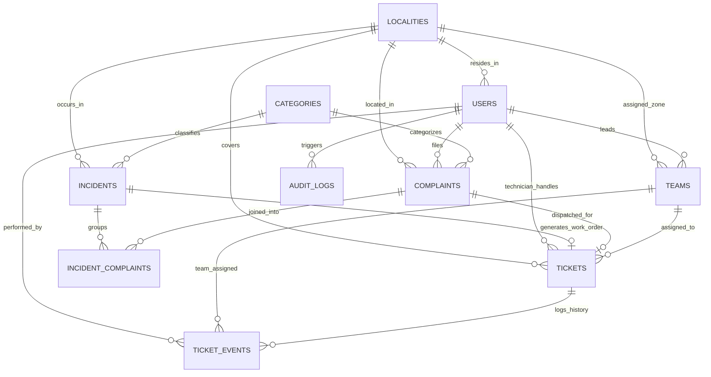

# NIVORA — Relational Database Architecture & Supabase Guide

This document specifies the complete 9-entity relational architecture, migration instructions, timezone convention, security controls, and database integrity verification procedures for **NIVORA**.

---

## 1. Relational Entity-Relationship Diagram (ERD)



---

## 2. The 9 Core Logical Entities

| Entity | Primary Key | Key Relationships & Purpose |
| :--- | :--- | :--- |
| **`localities`** | `id` (UUID / PK) | Wards and administrative water distribution sectors. Stores centroid coordinates and pipeline grids, enabling **locality-level geographic analysis without requiring public household coordinates**. |
| **`users` / `profiles`** | `id` (UUID / PK) | Citizens, field technicians, team leads, and central administrators. |
| **`teams`** | `id` (UUID / PK) | Field service crews and specialized repair divisions (e.g., Heavy Pipe Burst, Water Quality). |
| **`complaints`** | `id` (UUID / PK) | Citizen reports. Stores **`created_at`** (submission time) and **`occurred_at`** (incident observation time) **separately**. |
| **`incidents`** | `id` (UUID / PK) | Master infrastructure failures (e.g. broken 400mm feeder line). Carries unique `incident_number` (UK). |
| **`incident_complaints`** | `id` (UUID / PK) | Junction table linking **many complaints to one incident**, cleanly **preserving original complaints intact** with their landmarks and timestamps. |
| **`tickets`** | `id` (UUID / PK) | Master work orders dispatched to teams or technicians. Carries unique `ticket_number` (UK). |
| **`ticket_events`** | `id` (UUID / PK) | Comprehensive audit trail recording **status transitions**, **reassignments**, and **resolution events**. |
| **`audit_logs`** | `id` (UUID / PK) | System-wide immutable operations and security audit log. |

---

## 3. Timezone Convention

* **Database Storage**: All timestamps across all tables are strictly stored as **`TIMESTAMPTZ` in UTC (Coordinated Universal Time)** with standard **ISO 8601 formatting** (`YYYY-MM-DDTHH:MM:SSZ`).
* **Frontend Presentation**: Client applications parse UTC timestamps and convert them into the resident's local timezone (e.g., IST `+05:30`).

---

## 4. How to Apply Migrations

### Method A: Via Supabase Web Dashboard (Zero Installation Required)

1. Navigate to your project on the [Supabase Dashboard](https://supabase.com/dashboard).
2. Click on the **SQL Editor** tab on the left sidebar.
3. **Step 1 — Create Relational Schema**:
   * Open [**`supabase/migrations/20261024160000_nivora_relational_schema.sql`**](file:///c:/Users/LENOVO/Downloads/NIVORA/supabase/migrations/20261024160000_nivora_relational_schema.sql).
   * Copy the contents, paste into the SQL Editor, and click **Run**.
4. **Step 2 — Apply RLS & Access Policies**:
   * Open [**`supabase/migrations/20261024160001_nivora_rls_and_permissions.sql`**](file:///c:/Users/LENOVO/Downloads/NIVORA/supabase/migrations/20261024160001_nivora_rls_and_permissions.sql).
   * Copy the contents, paste into the SQL Editor, and click **Run**.
5. **Step 3 — Seed Relational Prototype Data**:
   * Open [**`supabase/seed.sql`**](file:///c:/Users/LENOVO/Downloads/NIVORA/supabase/seed.sql).
   * Copy the contents, paste into the SQL Editor, and click **Run**.
6. **Step 4 — Execute Database Integrity Tests**:
   * Open [**`supabase/tests/database_integrity_test.sql`**](file:///c:/Users/LENOVO/Downloads/NIVORA/supabase/tests/database_integrity_test.sql).
   * Copy, paste, and click **Run**. You will see:
     ```text
     TEST 1 PASSED: All 9 logical entities exist in public schema.
     TEST 2 PASSED: Timestamp separation verified (created_at and occurred_at exist separately).
     TEST 3 PASSED: Unique identifiers constrained for complaints, incidents, and tickets.
     TEST 4 PASSED: Many-to-one junction verified while preserving original complaints intact.
     TEST 5 PASSED: Locality geographic analysis view safely summarizes ward data without household coordinates.
     ALL POSTGRESQL DATABASE INTEGRITY TESTS PASSED SUCCESSFULLY!
     ```

---

## 5. Automated Database Integrity Tests (Active SQLite Environment)

You can run the automated integrity test suite directly in your development terminal:

```powershell
py backend/tests/test_database_integrity.py
```

Expected Output:
```text
Ran 7 tests in 0.009s
OK
PASS: All 9 logical entities verified in database.
PASS: Unique identifier enforcement verified for complaints, incidents, and tickets.
PASS: Timestamp separation verified.
PASS: Original complaint preservation verified across 3 linked reports.
PASS: Many-to-one junction cardinality verified.
PASS: Ticket events lifecycle audit verified.
PASS: Locality-level geographic aggregation verified across 4 wards.
```

---

## 6. Security & Secret Protection

* **Frontend Codebase**: The frontend relies strictly on standard REST endpoints and does not bundle or expose database passwords, connection URIs, or Supabase service_role keys.
* **Least Privilege**: Public anonymous users cannot scrape raw complaints; anonymous progress queries are mediated via cryptographically hashed tokens (`get_anonymous_complaint_status`).
